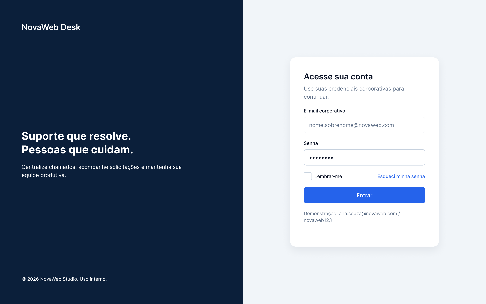
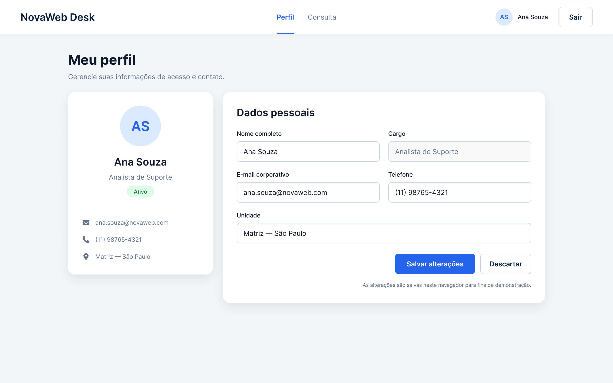
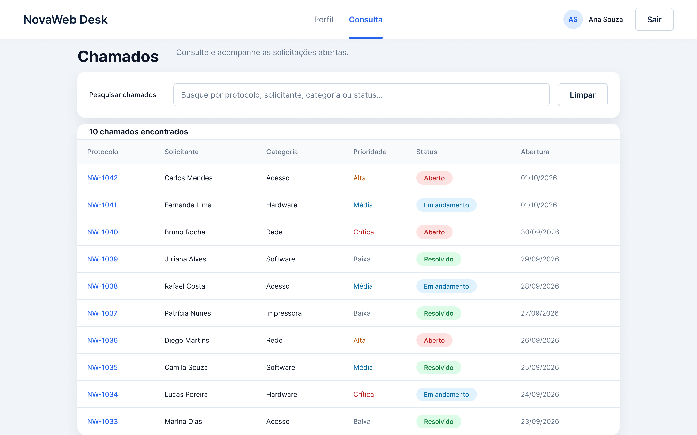
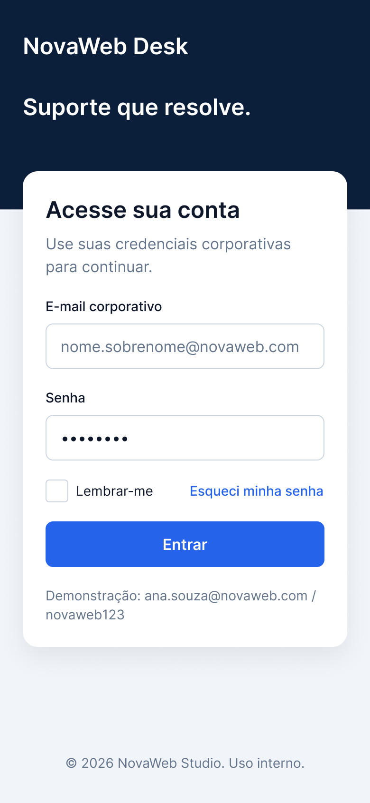
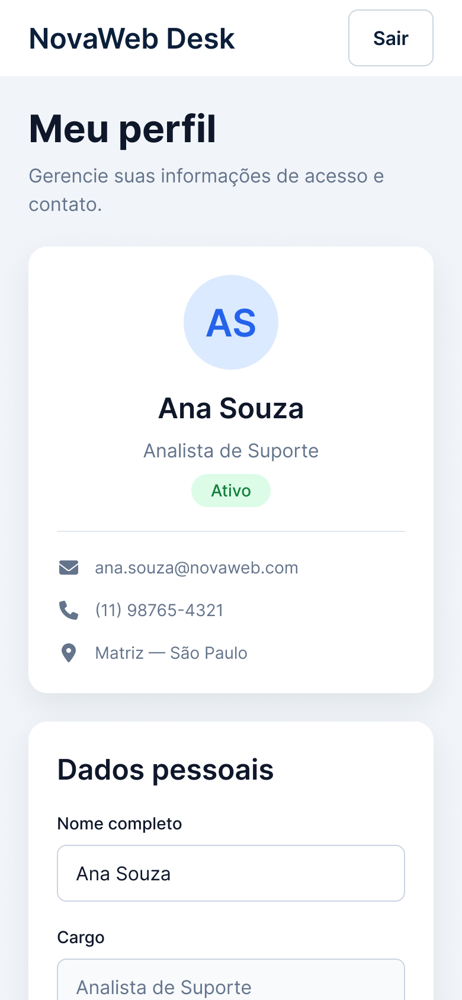
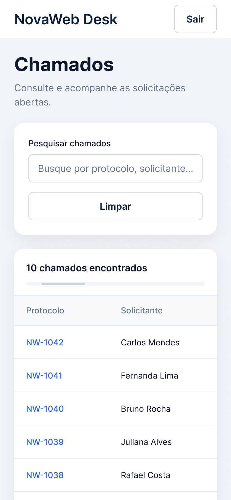

# NovaWeb Desk — SA02

Interface web de um sistema interno de suporte: **login**, **perfil do usuário** e **consulta de chamados** com tabela e pesquisa. Projeto individual da Situação de Aprendizagem 02 (SA02), publicado como repositório público no GitHub.

- **Autora:** Raquel Duarte
- **Status:** em desenvolvimento (protótipo concluído)

---

## 1. Sobre o projeto

O NovaWeb Desk é a interface de um sistema de gestão de chamados de TI. O fluxo tem três telas:

1. **Login** — entrada com e-mail corporativo e senha.
2. **Perfil** — dados do usuário autenticado e formulário de edição.
3. **Consulta** — lista de chamados com pesquisa e filtragem visual.

Não há backend: o login é simulado no navegador (`sessionStorage`/`localStorage`), o que atende ao escopo de front-end da atividade.

---

## 2. Status atual

| Etapa | Situação |
|---|---|
| Protótipo no Figma (desktop e mobile) | Concluído, PNGs em `docs/prototipo/` |
| HTML, CSS e JavaScript | Em desenvolvimento |

---

## 3. Protótipo

- **Figma:** link público não aplicável; a evidência do protótipo são os PNGs abaixo.
- **Prints:** exportados em PNG 2x (desktop `2880 × 1800`, mobile `780 × 1688`).

### Desktop

<p>
  
  
  
</p>

### Mobile

<p>
  
  
  
</p>

Regra do projeto: o site final deve parecer uma continuação direta do protótipo — mesmas cores, fontes, espaçamentos e textos.

---

## 4. Identidade visual

### Cores

| Uso | Hex |
|---|---|
| Marca / Navy | `#0B1F3A` |
| Acento / Blue | `#2563EB` |
| Acento / Cyan | `#06B6D4` |
| Fundo | `#F1F5F9` |
| Superfície | `#FFFFFF` |
| Texto | `#0F172A` |
| Texto suave | `#64748B` |
| Borda | `#CBD5E1` |
| Sucesso | `#15803D` |
| Alerta | `#B45309` |
| Perigo | `#B91C1C` |
| Info | `#0369A1` |

### Tipografia

Fonte: **Inter** (fallback: fonte do sistema).

| Estilo | Tamanho / altura | Peso |
|---|---|---|
| Título / 32 | 32 / 40 | Bold |
| Título / 24 | 24 / 32 | Semi Bold |
| Corpo / 16 | 16 / 24 | Regular |
| Corpo forte / 16 | 16 / 24 | Semi Bold |
| Apoio / 14 | 14 / 20 | Regular |
| Apoio forte / 14 | 14 / 20 | Medium |

### Medidas

- Desktop: `1440 × 900`. Mobile: `390 × 844`.
- Conteúdo: largura máxima `1120`, centralizado.
- Cartões: padding `32`, raio `16`, sombra `0 10 30 rgba(15,23,42,0.08)`.
- Inputs e botões: altura `48`, raio `8`.
- Espaço entre campos: `20`.

---

## 5. Estrutura do repositório

```
.
├── README.md
├── .gitignore
├── docs/
│   └── prototipo/                  # PNGs exportados do Figma
├── imagens/                        # imagens livres usadas no projeto
├── css/
└── js/
```

A estrutura do site será criada na fase de código:

```
├── index.html
├── perfil.html
├── consulta.html
├── css/style.css
├── js/app.js
└── assets/images/
```

---

## 6. Stack prevista

- **HTML5** semântico e formulários com labels.
- **CSS externo** (`css/style.css`) — proibido CSS inline ou `<style>`.
- **JavaScript puro** para login simulado, edição de perfil e filtragem da tabela.
- **Bootstrap local** (sem CDN), se necessário para componentes.
- **GitHub Pages** para publicar a versão estática.

---

## 7. Como executar (quando o código existir)

1. Clone o repositório.
2. Abra `index.html` no navegador ou rode um servidor local (`python3 -m http.server`).
3. Entre com a conta de demonstração: `ana.souza@novaweb.com` / `novaweb123`.

---

## 8. Decisões do projeto

- Tema NovaWeb Desk: sistema interno de chamados de TI.
- Stack HTML + CSS externo + JavaScript puro + Bootstrap local.
- Protótipo com 3 telas desktop e 3 mobile.
- Login simulado com `sessionStorage`/`localStorage` (sem backend).

---

## 9. Imagens e licenças

Imagens livres baixadas para o protótipo (login/avatar). Créditos:

| Arquivo | Autor | Origem | Licença |
|---|---|---|---|
| `israel-andrade-YI_9SivVt_s-unsplash.jpg` | Israel Andrade | [Unsplash](https://unsplash.com/photos/YI_9SivVt_s) | [Unsplash License](https://unsplash.com/license) |
| `hendi-perkasa-asRqoZDUDVw-unsplash.png` | Hendi Perkasa | [Unsplash](https://unsplash.com/photos/asRqoZDUDVw) | [Unsplash License](https://unsplash.com/license) |
| `kushal-mistri-mSHEr4Kx4vY-unsplash.png` | Kushal Mistri | [Unsplash](https://unsplash.com/photos/mSHEr4Kx4vY) | [Unsplash License](https://unsplash.com/license) |
| `boxicons-bef6RRQiz4o-unsplash.png` | Boxicons | [Unsplash](https://unsplash.com/photos/bef6RRQiz4o) | [Unsplash License](https://unsplash.com/license) |

Antes de publicar, converter as imagens usadas para WebP e servir com `srcset`, para atender ao critério de desempenho (nenhuma imagem de 2 MB ou mais na página).

---

## 10. Ferramentas

- **Figma** (plano gratuito) para o protótipo.
- **VS Code** para o código.
- **Git/GitHub** para versionamento e publicação.
